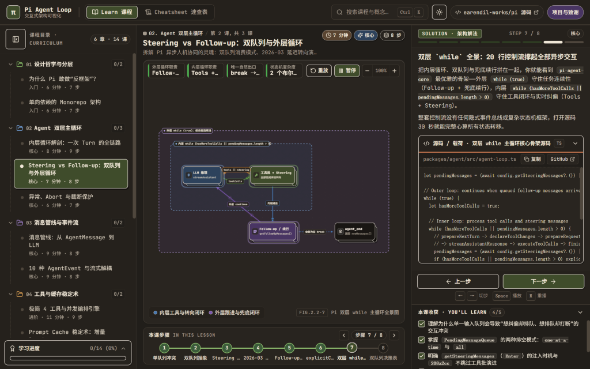
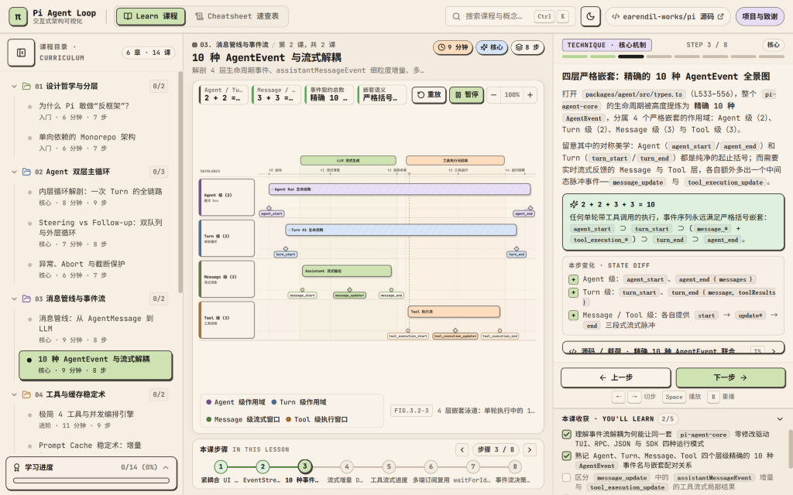
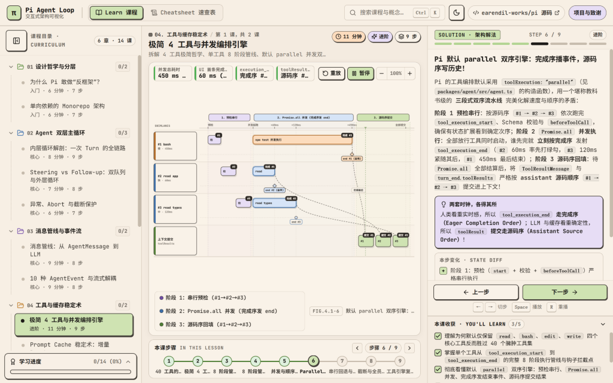
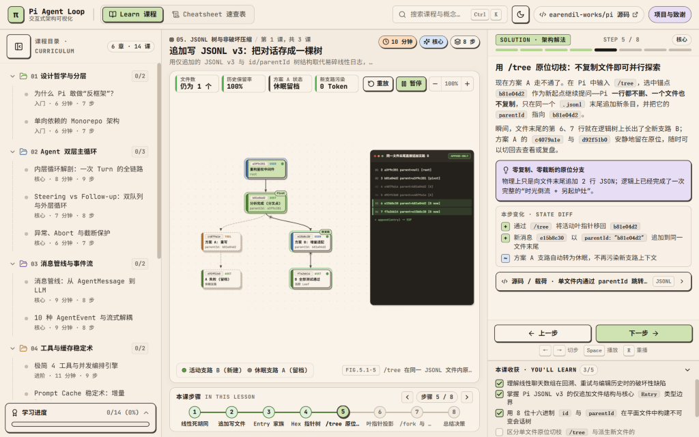
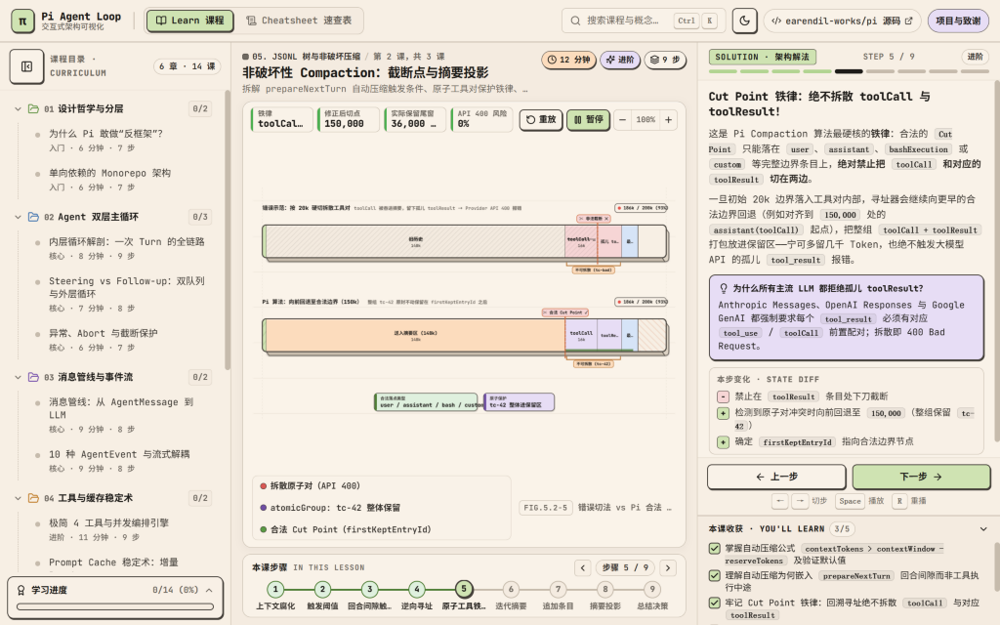
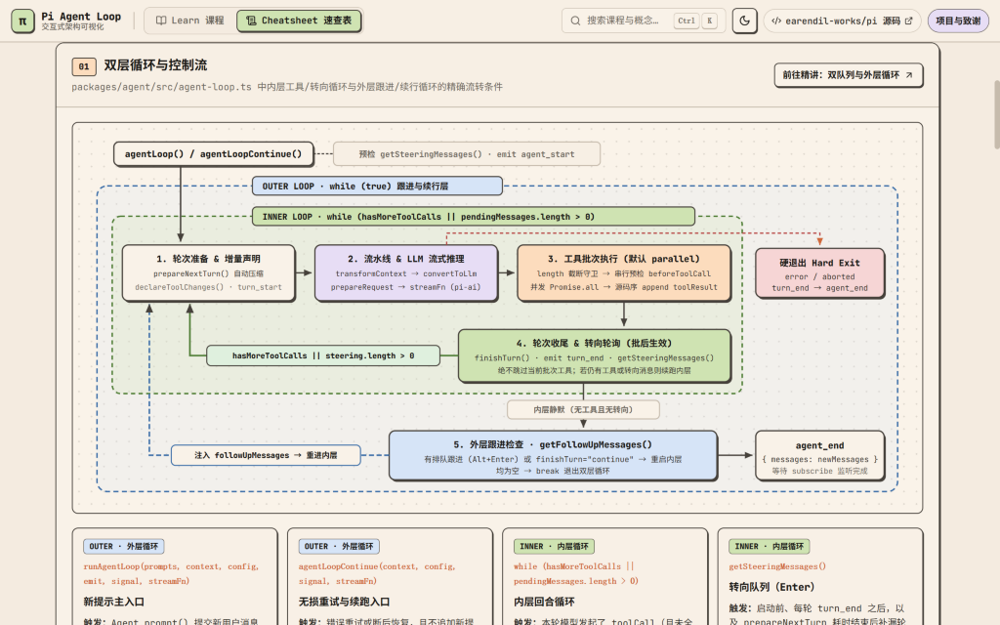

# Pi Agent Loop Visualizer

<p>
  <strong>English</strong> &nbsp;|&nbsp; <a href="README.zh.md">简体中文</a>
</p>

> An interactive, step-through visual guide to **[Pi Coding Agent](https://github.com/earendil-works/pi)** (`earendil-works/pi`, formerly `badlogic/pi-mono`) — dissecting its double-loop runtime, message pipeline, parallel tool engine, JSONL session tree, non-destructive compaction, and Codemode MCP.

<p>
  <a href="https://pi-visualizer-lemon.vercel.app/"><strong>🚀 Live Demo</strong></a>
  &nbsp;·&nbsp;
  <a href="https://pi-visualizer-lemon.vercel.app/#/cheatsheet"><strong>📋 Architecture Cheatsheet</strong></a>
  &nbsp;·&nbsp;
  <a href="https://github.com/earendil-works/pi/releases/tag/v1.5.2"><strong>📌 Verified against Pi v1.5.2</strong></a>
</p>

> **Language note:** The interactive web app itself is written in Simplified Chinese (preserving Pi's native English API/code identifiers).

---

## Visual Showcase

Built as a fixed-viewport 3-column learning workbench with four pure inline SVG visualizers — **2.5D isometric flow**, **event/tool swimlanes**, **JSONL session trees**, and **token-budget slices** — across both warm-paper Light and warm-espresso Dark themes:

<table>
  <tr>
    <td width="50%" valign="top">
      <a href="https://pi-visualizer-lemon.vercel.app/#/learn/steering-followup/7">
        
      </a>
      <br />
      <strong>1. Double-Loop Runtime &amp; Source Drawer (Dark Theme)</strong>
      <br />
      <sub>Visualizes the outer <code>while (true)</code> loop (Follow-up continuation) and inner loop (Tools + Steering) from <code>agent-loop.ts</code>, paired with an expandable source drawer.</sub>
    </td>
    <td width="50%" valign="top">
      <a href="https://pi-visualizer-lemon.vercel.app/#/learn/agent-events/3">
        
      </a>
      <br />
      <strong>2. Exact 10 <code>AgentEvent</code> Nested Swimlanes</strong>
      <br />
      <sub>Maps all 10 lifecycle events across 4 strictly nested scopes (Agent / Turn / Message / Tool), showing how TUI, RPC, and SDK consume the same stream.</sub>
    </td>
  </tr>
  <tr>
    <td width="50%" valign="top">
      <a href="https://pi-visualizer-lemon.vercel.app/#/learn/tool-execution/6">
        
      </a>
      <br />
      <strong>3. Default Parallel Tool Engine (Dual Ordering)</strong>
      <br />
      <sub>Breaks down the 3-stage pipeline: sequential preflight (<code>beforeToolCall</code>) → concurrent <code>Promise.all</code> → completion-order <code>tool_execution_end</code> → source-order <code>toolResult</code> commit.</sub>
    </td>
    <td width="50%" valign="top">
      <a href="https://pi-visualizer-lemon.vercel.app/#/learn/jsonl-session-tree/5">
        
      </a>
      <br />
      <strong>4. Append-Only JSONL v3 Session Tree</strong>
      <br />
      <sub>Pairs the logical <code>id / parentId</code> tree with an append-only JSONL terminal view to show how <code>/tree</code> branches in place without duplicating files.</sub>
    </td>
  </tr>
  <tr>
    <td width="50%" valign="top">
      <a href="https://pi-visualizer-lemon.vercel.app/#/learn/compaction/5">
        
      </a>
      <br />
      <strong>5. Non-Destructive Compaction &amp; Cut Point Rule</strong>
      <br />
      <sub>Contrasts naive token truncation (splitting tool pairs and causing API 400 errors) with Pi's reverse boundary scan that keeps <code>toolCall + toolResult</code> intact.</sub>
    </td>
    <td width="50%" valign="top">
      <a href="https://pi-visualizer-lemon.vercel.app/#/cheatsheet">
        
      </a>
      <br />
      <strong>6. One-Page Architecture Cheatsheet</strong>
      <br />
      <sub>Collects the double-loop master map, 10-event contract, message pipeline, default thresholds, JSONL entry types, and MCP exposure modes with direct jumps to each lesson.</sub>
    </td>
  </tr>
</table>

---

## Curriculum Overview

**6 chapters · 14 lessons · 111 interactive steps**, each featuring live KPI chips, step-by-step state diffs, collapsible source/payload drawers, and an end-of-lesson decision recap table:

| Chapter | Lessons | Key Concepts |
| --- | --- | --- |
| **01. Philosophy &amp; Layers** | Why Pi Is "Anti-Framework" / Unidirectional Monorepo Layers | 4 core tools, `<1k token` baseline prompt, acyclic package DAG, OpenClaw integration |
| **02. Double-Loop Core** | Inner Loop Anatomy / Steering vs. Follow-up / Abort &amp; Guards | `agentLoop`, `PendingMessageQueue`, `stopReason="length"` guard, `agentLoopContinue` |
| **03. Pipeline &amp; Events** | From `AgentMessage` to LLM / 10 `AgentEvent`s &amp; Decoupling | `transformContext` → `convertToLlm`, `EventStream`, `waitForIdle()` settlement |
| **04. Tools &amp; Prompt Cache** | Minimal 4 Tools &amp; Parallel Engine / Prompt Cache Stability | 8-stage tool pipeline, `Promise.all` dual ordering, delta `SystemMessage` patches |
| **05. Session Tree &amp; Compaction** | Append-Only JSONL v3 / Non-Destructive Compaction / Branch Summary | `SessionManager`, `/tree` vs `/fork`, `CompactionEntry`, LCA `BranchSummaryEntry` |
| **06. Extensions &amp; Codemode MCP** | Extensions &amp; Skills / From Anti-MCP to Codemode MCP | `ExtensionAPI` hot reload, `SKILL.md` progressive disclosure, `pi-codemode` zero-bloat discovery |

---

## Interactive Features

- **Step-Driven SVG Stage**: Navigate with `←` / `→`, toggle live packet animations with `Space`, replay with `R`, and zoom/pan directly on the canvas.
- **On-Demand Source &amp; Payload Drawer**: Keeps explanations concise while letting you expand verified TypeScript snippets, JSONL lines, and `AgentEvent` payloads with direct GitHub links.
- **Command Palette (`Ctrl+K` / `⌘K`) &amp; Shareable Deep Links**: Search across lessons, steps, and cheatsheet sections; share any exact step via `#/learn/<slug>/<step>`.
- **Zero-Backend Static App**: Progress and Light/Dark theme preferences persist in `localStorage`. All animations and numbers are illustrative; the site does not run Pi or call LLM APIs.

---

## Quick Start

Requires **Node.js 22+**.

```sh
npm ci
npm run dev
```

```sh
# Type-check with TypeScript and build static assets into dist/
npm run build

# Preview the production bundle locally
npm run preview
```

Production deployments build automatically on Vercel from the `main` branch at [pi-visualizer-lemon.vercel.app](https://pi-visualizer-lemon.vercel.app/).

---

## Upstream Verification

Lessons and cheatsheet entries were verified on 2026-11-20 against **[Pi v1.5.2](https://github.com/earendil-works/pi/releases/tag/v1.5.2)**, with source links pinned to that release. Code drawers contain teaching-focused excerpts, and token counts, cache hit rates, and timings in diagrams are illustrative.

| Scope | Upstream References |
| --- | --- |
| Default tools, project trust, package layering | [CLI](https://github.com/earendil-works/pi/blob/v1.5.2/packages/coding-agent/docs/cli.md#tools), [Security](https://github.com/earendil-works/pi/blob/v1.5.2/packages/coding-agent/docs/security.md), [Packages](https://github.com/earendil-works/pi/tree/v1.5.2/packages) |
| Double loop, steering/follow-up queues, abort | [Agent](https://github.com/earendil-works/pi/blob/v1.5.2/packages/agent/src/agent.ts), [Agent Loop](https://github.com/earendil-works/pi/blob/v1.5.2/packages/agent/src/agent-loop.ts) |
| Message conversion, events, tool execution | [Messages](https://github.com/earendil-works/pi/blob/v1.5.2/packages/coding-agent/src/core/messages.ts), [Event Types](https://github.com/earendil-works/pi/blob/v1.5.2/packages/agent/src/types.ts) |
| Prompt caching | [Settings](https://github.com/earendil-works/pi/blob/v1.5.2/packages/coding-agent/docs/settings.md), [Cache Warmer](https://github.com/earendil-works/pi/blob/v1.5.2/packages/coding-agent/src/core/cache-warmer.ts) |
| JSONL sessions, compaction, branch summary | [Session Format](https://github.com/earendil-works/pi/blob/v1.5.2/packages/coding-agent/docs/session-format.md), [Compaction](https://github.com/earendil-works/pi/blob/v1.5.2/packages/coding-agent/docs/compaction.md) |
| Extensions, Skills, and MCP | [Extensions](https://github.com/earendil-works/pi/blob/v1.5.2/packages/coding-agent/docs/extensions.md), [Skills](https://github.com/earendil-works/pi/blob/v1.5.2/packages/coding-agent/docs/skills.md), [MCP Exposure Modes](https://github.com/earendil-works/pi/blob/v1.5.2/packages/coding-agent/docs/mcp.md#control-tool-exposure) |

> **Release vs. `main` note:** The Abort lesson highlights a behavior difference between `v1.5.2` (which may exit a tool batch mid-way) and the verified [`main` implementation](https://github.com/earendil-works/pi/blob/1e34c3b4c7df78e716a8f53ad0bcf3a00feceedc/packages/agent/src/agent-loop.ts) (which emits synthetic abort results for un-preflighted tool calls).

---

## Credits &amp; License

- **Pi Coding Agent**: Architecture and flows are based on [Pi Coding Agent](https://github.com/earendil-works/pi) by [Mario Zechner (badlogic)](https://github.com/badlogic) and its contributors.
- **Designed to Scale**: The 3-column interactive workbook layout and tactile drafting-paper aesthetic are inspired by [Designed to Scale](https://designed-to-scale.vercel.app/) by [Dilum Sanjaya](https://dilum.dev/).
- **Maintenance &amp; Notices**: Independent educational project maintained by Chasen Liao. Teaching excerpts are simplified for clarity; refer to upstream Pi source for exact runtime behavior. Upstream Pi excerpts follow the [MIT License](THIRD_PARTY_NOTICES.md).
