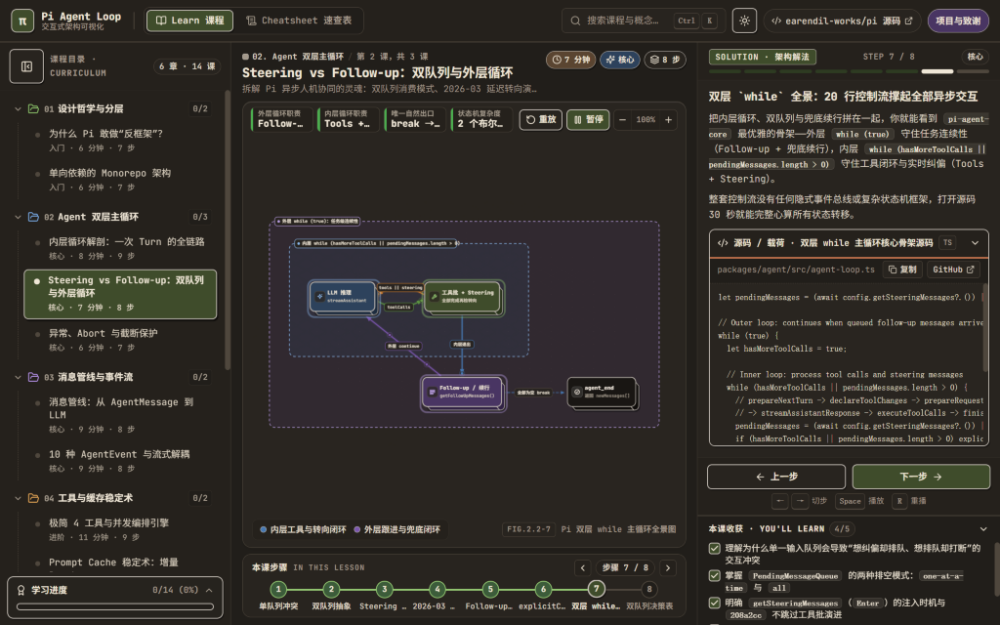
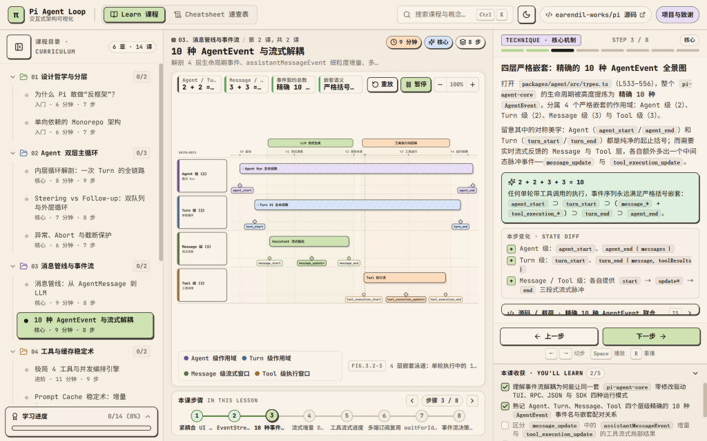
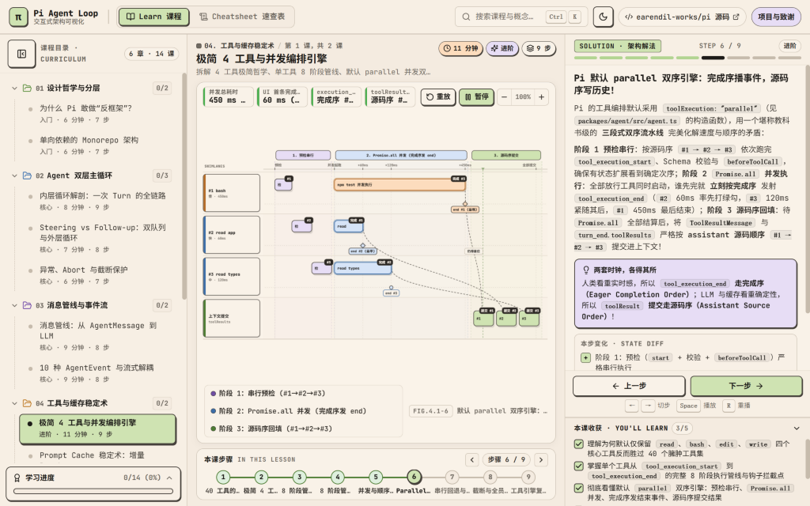
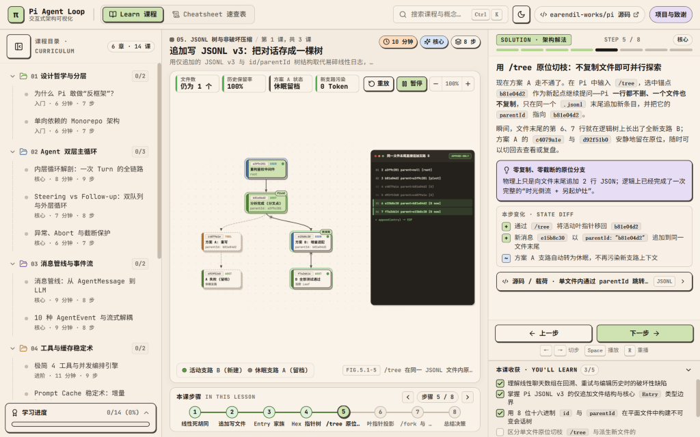
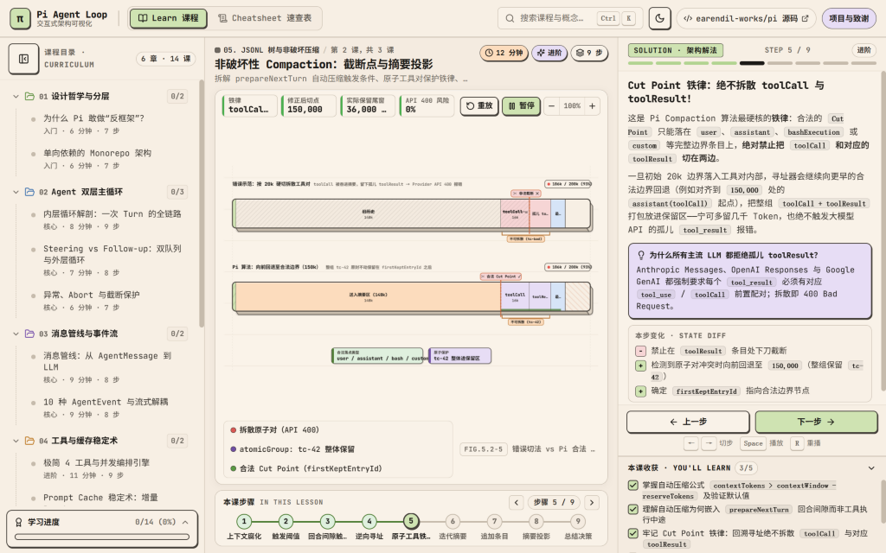
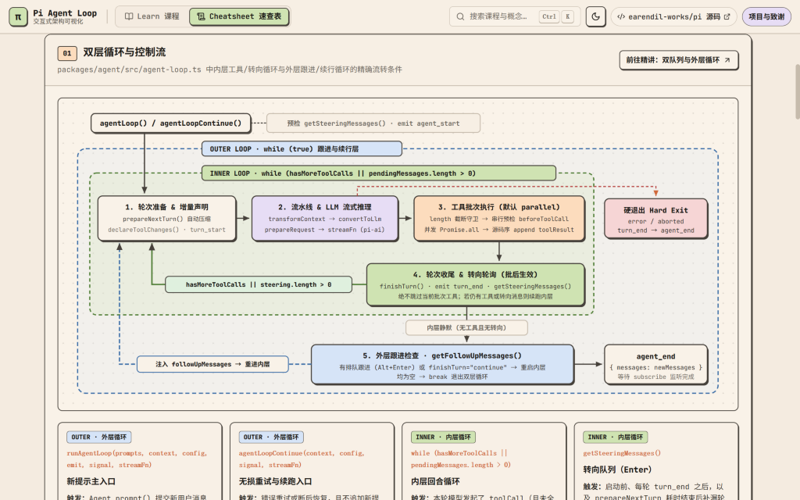

# Pi Agent Loop 可视化教程

<p>
  <a href="README.md">English</a> &nbsp;|&nbsp; <strong>简体中文</strong>
</p>

> 以步进式交互动画与源码对照，完整拆解极简编程代理 **[Pi Coding Agent](https://github.com/earendil-works/pi)**（`earendil-works/pi`，原 `badlogic/pi-mono`）的 Agent Loop 与核心工程架构。

<p>
  <a href="https://pi-visualizer-lemon.vercel.app/"><strong>🚀 在线学习</strong></a>
  &nbsp;·&nbsp;
  <a href="https://pi-visualizer-lemon.vercel.app/#/cheatsheet"><strong>📋 架构速查表</strong></a>
  &nbsp;·&nbsp;
  <a href="https://github.com/earendil-works/pi/releases/tag/v1.5.2"><strong>📌 对照版本：Pi v1.5.2</strong></a>
</p>

---

## 核心界面与架构图览

全站采用固定视口三栏工作台，按概念形态混用 **2.5D 等距流图**、**事件/并发泳道**、**JSONL 会话树** 与 **Token 窗口切片** 四类纯内联 SVG 舞台（支持浅色草图纸 / 深色浓缩咖啡双主题）：

<table>
  <tr>
    <td width="50%" valign="top">
      <a href="https://pi-visualizer-lemon.vercel.app/#/learn/steering-followup/7">
        
      </a>
      <br />
      <strong>1. 双层主循环与深色源码抽屉</strong>
      <br />
      <sub>展示 <code>agent-loop.ts</code> 的外层 <code>while (true)</code>（Follow-up 续跑）与内层（Tools + Steering 实时纠偏）闭环，支持在右侧一键展开真实源码对照。</sub>
    </td>
    <td width="50%" valign="top">
      <a href="https://pi-visualizer-lemon.vercel.app/#/learn/agent-events/3">
        
      </a>
      <br />
      <strong>2. 10 种 AgentEvent 严格嵌套泳道</strong>
      <br />
      <sub>以 4 层泳道（Agent / Turn / Message / Tool）呈现精确 10 种标准事件如何满足括号配对，驱动 TUI / RPC / SDK 零耦合渲染。</sub>
    </td>
  </tr>
  <tr>
    <td width="50%" valign="top">
      <a href="https://pi-visualizer-lemon.vercel.app/#/learn/tool-execution/6">
        
      </a>
      <br />
      <strong>3. 默认 Parallel 双序工具引擎</strong>
      <br />
      <sub>拆解三段式并发流水线：串行预检 <code>beforeToolCall</code> → <code>Promise.all</code> 并发执行 → 按完成序发 <code>tool_execution_end</code> → 按源码序回填 <code>toolResult</code>。</sub>
    </td>
    <td width="50%" valign="top">
      <a href="https://pi-visualizer-lemon.vercel.app/#/learn/jsonl-session-tree/5">
        
      </a>
      <br />
      <strong>4. 追加写 JSONL v3 会话树</strong>
      <br />
      <sub>左右联动对照逻辑树与磁盘仅追加 JSONL 终端，直观演示 <code>/tree</code> 如何通过 <code>id / parentId</code> 在单文件内零复制切枝。</sub>
    </td>
  </tr>
  <tr>
    <td width="50%" valign="top">
      <a href="https://pi-visualizer-lemon.vercel.app/#/learn/compaction/5">
        
      </a>
      <br />
      <strong>5. 非破坏性 Compaction 与截断点铁律</strong>
      <br />
      <sub>对比硬切拆散工具对触发 API 400 报错与 Pi 逆向回退至合法边界的算法，保证 <code>toolCall + toolResult</code> 永不被拆散。</sub>
    </td>
    <td width="50%" valign="top">
      <a href="https://pi-visualizer-lemon.vercel.app/#/cheatsheet">
        
      </a>
      <br />
      <strong>6. 一页式架构速查表</strong>
      <br />
      <sub>汇总双层控制流总览图、10 种事件契约、消息管线、默认阈值参数、JSONL Entry 家族与 MCP 四种暴露模式，并支持一键跳回对应课程步骤。</sub>
    </td>
  </tr>
</table>

---

## 课程地图

共 **6 章 · 14 课 · 111 步**，每课均含 KPI 状态指示、步进 Diff、可折叠源码/载荷抽屉及结尾设计决策表（Recap）：

| 章节 | 课程内容 | 覆盖核心机制 |
| --- | --- | --- |
| **01. 设计哲学与分层** | 为什么 Pi 敢做“反框架”？ / 单向依赖的 Monorepo 架构 | 4 核心工具、`<1k token` 基线提示词、单向 DAG 分层与 OpenClaw 底座 |
| **02. Agent 双层主循环** | 内层循环解剖 / Steering vs Follow-up / 异常、Abort 与截断保护 | `agentLoop`、`PendingMessageQueue`、`stopReason="length"` 熔断与 `agentLoopContinue` |
| **03. 消息管线与事件流** | 消息管线：从 `AgentMessage` 到 LLM / 10 种 `AgentEvent` 与流式解耦 | `transformContext` → `convertToLlm`、`EventStream` 与 `waitForIdle()` |
| **04. 工具与缓存稳定术** | 极简 4 工具与并发编排引擎 / Prompt Cache 稳定术：增量 Patch | 8 阶段工具管线、`Promise.all` 双序、增量 `SystemMessage` 保 KV Cache |
| **05. JSONL 树与非破坏压缩** | 追加写 JSONL v3 会话树 / 非破坏性 Compaction / 分支摘要与知识回流 | `SessionManager`、`/tree` 与 `/fork`、`CompactionEntry`、LCA `BranchSummaryEntry` |
| **06. 扩展生态与现代演进** | Extensions 与 Skills 渐进装配 / 从拒绝 MCP 到 Codemode MCP | `ExtensionAPI` 热重载、`SKILL.md` 渐进披露、`pi-codemode` 零预载发现 |

---

## 交互特性

- **步进式架构舞台**：支持 `←` / `→` 切步、`Space` 暂停/继续粒子流、`R` 重放动画，画布支持滚轮缩放与拖拽平移。
- **源码 / 载荷按需对照**：正文保持极简直觉讲解，关键步骤可折叠展开对应 TypeScript 源码、JSONL 条目或 `AgentEvent` 载荷并直达上游仓库。
- **全局检索与速查**：支持 `Ctrl+K` / `⌘K` 全文搜索课程、步骤与速查表，方向键选择、回车跳转；Hash 链接（`#/learn/<slug>/<step>`）可直接分享到任意一步。
- **纯前端静态交付**：学习进度与浅/深双主题保存在当前浏览器 `localStorage`；动画与示例仅用于教学，网页不会运行 Pi 或调用模型 API。

---

## 本地运行

使用 **Node.js 22** 或更新版本：

```sh
npm ci
npm run dev
```

```sh
# 执行 TypeScript 类型检查并生成 dist/
npm run build

# 预览生产构建产物
npm run preview
```

Vercel 通过 GitHub 的 `main` 分支自动构建生产站点：[pi-visualizer-lemon.vercel.app](https://pi-visualizer-lemon.vercel.app/)。

---

## Pi 版本与核对范围

2026-11-20 对照 **[Pi v1.5.2](https://github.com/earendil-works/pi/releases/tag/v1.5.2)** 核对课程和速查表，课程链接固定到对应版本。源码抽屉含教学摘编，图中的 Token、缓存命中率和耗时为示例数据。

| 课程范围 | 上游参考 |
| --- | --- |
| 默认工具、项目权限和包分层 | [CLI](https://github.com/earendil-works/pi/blob/v1.5.2/packages/coding-agent/docs/cli.md#tools)、[项目权限](https://github.com/earendil-works/pi/blob/v1.5.2/packages/coding-agent/docs/security.md)、[包定义](https://github.com/earendil-works/pi/tree/v1.5.2/packages) |
| 双层循环、双队列和中止 | [Agent](https://github.com/earendil-works/pi/blob/v1.5.2/packages/agent/src/agent.ts)、[Agent Loop](https://github.com/earendil-works/pi/blob/v1.5.2/packages/agent/src/agent-loop.ts) |
| 消息转换、事件和工具执行 | [消息转换](https://github.com/earendil-works/pi/blob/v1.5.2/packages/coding-agent/src/core/messages.ts)、[事件类型](https://github.com/earendil-works/pi/blob/v1.5.2/packages/agent/src/types.ts) |
| Prompt 缓存 | [缓存设置](https://github.com/earendil-works/pi/blob/v1.5.2/packages/coding-agent/docs/settings.md)、[缓存预热实现](https://github.com/earendil-works/pi/blob/v1.5.2/packages/coding-agent/src/core/cache-warmer.ts) |
| JSONL 会话、压缩和分支摘要 | [会话文件格式](https://github.com/earendil-works/pi/blob/v1.5.2/packages/coding-agent/docs/session-format.md)、[压缩与分支摘要](https://github.com/earendil-works/pi/blob/v1.5.2/packages/coding-agent/docs/compaction.md) |
| 扩展、Skills 和 MCP | [扩展 API](https://github.com/earendil-works/pi/blob/v1.5.2/packages/coding-agent/docs/extensions.md)、[Skills](https://github.com/earendil-works/pi/blob/v1.5.2/packages/coding-agent/docs/skills.md)、[MCP 暴露模式](https://github.com/earendil-works/pi/blob/v1.5.2/packages/coding-agent/docs/mcp.md#control-tool-exposure) |

> **版本差异注记**：中止一课标出了发行版与主分支的区别。`v1.5.2` 可能中途结束工具批次，核对时的 [主分支实现](https://github.com/earendil-works/pi/blob/1e34c3b4c7df78e716a8f53ad0bcf3a00feceedc/packages/agent/src/agent-loop.ts) 会为尚未预检的调用补上中止结果。

---

## 参考与致谢

- 课程的架构与流程参考了 [Mario Zechner（badlogic）](https://github.com/badlogic) 创建的 [Pi Coding Agent](https://github.com/earendil-works/pi)。感谢 Mario 和 Pi 的所有贡献者公开源码与文档，让我们能沿着实际实现学习 Agent 的设计。
- 网页的交互式教学设计受到 [Dilum Sanjaya](https://dilum.dev/) 的 [Designed to Scale](https://designed-to-scale.vercel.app/) 启发。感谢他分享用可逐步播放的动画图解讲解系统架构的设计思路。
- 这是 Chasen Liao 维护的独立中文学习项目。课程中的示例包含为教学简化的代码，具体行为请以对应版本的 Pi 源码为准。Pi 源码及节选遵循 [上游 MIT 许可证](THIRD_PARTY_NOTICES.md)。
